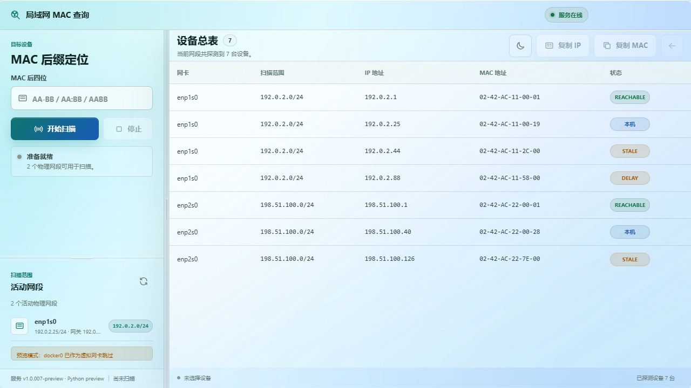
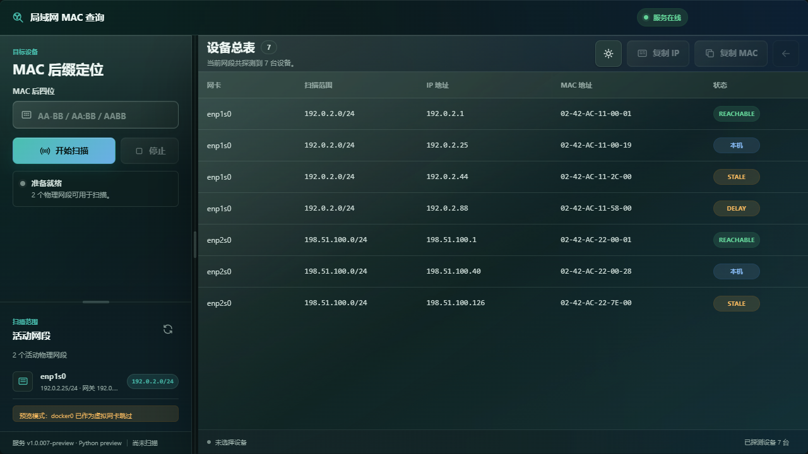

# LAN MAC Finder for TOS 7

`lan-mac-finder` is a TOS 7 iframe Deb application for finding devices in the
NAS's current physical LAN by the last four characters of their MAC address.

Current version: `1.0.007`.

## Features

- Detect physical IPv4 interfaces that have a default gateway.
- Exclude common virtual interfaces such as Docker, veth, VM, Tailscale, TUN,
  TAP, WireGuard, and ZeroTier.
- Calculate the real network and broadcast address from each interface prefix.
- Reject oversized scan ranges with a configurable safety limit.
- Probe hosts in the background, never blocking the WebUI.
- Prime the kernel neighbor table with empty UDP datagrams and use ICMP ping
  when the local `ping` command is available.
- Read `REACHABLE`, `STALE`, `DELAY`, and `PROBE` neighbor records.
- Match `AA-BB`, `AA:BB`, and `AABB` suffixes case-insensitively.
- Preserve the exact casing typed in the input while comparing the normalized suffix.
- Keep incomplete input neutral while the field is focused, while rejecting
  overlong fragments immediately and exposing the error state to assistive
  technology.
- Show the complete accepted-format hint directly inside the empty input.
- Actively probe every scannable host on startup and refresh, then show the
  complete discovered inventory as the device overview before searching.
- Include each physical interface's own MAC as a `LOCAL` device.
- Clear the search field to return immediately to the unfiltered device overview.
- Keep a submitted non-empty suffix searching automatically. A cycle refreshes
  physical networks, retains the latest match while the next scan is running,
  shows the no-match state when a completed scan returns no devices, retries
  after temporary NAS or API loss, and resumes after the WebUI reloads.
- Resize the navigation and scan/network boundaries with the mouse, touch, or
  keyboard while preserving minimum content sizes.
- Copy either the selected device's IP or MAC address.
- Follow the TOS `themeMode` on startup and provide a directly clickable
  application theme toggle.
- Version-bump the packaged icon mtime so TOS navigation cache-busts updated
  application artwork.
- Stop an active scan, refresh interfaces, select a result, and copy its MAC.
- Liquid-glass light/dark themes, custom tooltips, and TOS-safe window layout.

## Screenshot

The screenshots use RFC 5737 example addresses and synthetic MAC values; they
do not contain data from a real NAS or customer network.





## How it works

The app has no Windows dependency. The TOS package runs a Python 3 standard
library service as the non-root `lan-mac-finder` user and exposes an HTTP API
over `/var/api/lan-mac-finder.sock`.

Main endpoints:

```text
GET  /health
GET  /networks
GET  /devices
POST /devices/scan
POST /scan/start
GET  /scan/status
POST /scan/stop
```

The WebUI uses the TOS proxy prefix:

```text
/v2/proxy/lan-mac-finder/
```

## Runtime paths

```text
/usr/local/lan-mac-finder/
/usr/local/lan-mac-finder/data/
/usr/local/lan-mac-finder/logs/
/var/api/lan-mac-finder.sock
```

The application only reads routing, interface, and neighbor data. It never
changes NAS or remote-device network settings.

## Development

Requirements:

- Python 3.10 or newer
- TOS 7 NAS for package and real-network validation
- Node.js 20 or newer for frontend state tests
- Playwright only for optional local visual checks

Run the unit tests:

```powershell
py -3 -m unittest discover -s backend/tests -v
node --check frontend/app.js
node --test tests/frontend_search_state.test.js
```

Compile-check the backend:

```powershell
py -3 -m compileall -q backend
```

Run the deterministic local WebUI preview:

```powershell
py -3 tools/preview_server.py --port 4178
```

Then open `http://127.0.0.1:4178/`. The preview server is development tooling
only and is not included in the Deb package.

Build both package architectures:

```powershell
py -3 build.py --platform x86_64
py -3 build.py --platform aarch64
```

Generated packages and SHA256 files are written to `dist/`.

## TOS installation

For a test NAS:

```bash
sudo dpkg -i lan-mac-finder_1.0.007_x86_64.deb
systemctl status lanmacfinder-system.service
curl --unix-socket /var/api/lan-mac-finder.sock http://localhost/health
```

For normal distribution, upload the matching Deb from the GitHub Release to
the TerraMaster developer platform or install it through App Center.

## Safety and compatibility

- Windows PowerShell 5.1 is supported by the original standalone WPF tool, not
  by this TOS package. The TOS version is a separate Linux/iframe application.
- `config.ini` uses strict JSON contents despite its extension.
- `/var/api` is shared and sticky on TOS. This package does not change its owner
  or permissions.
- `webui.bz2` is re-extracted during every package configure.
- The systemd unit uses the application user's real primary group instead of a
  nonexistent same-named group.
- `PrivateTmp=true` is not used because `/var/api` may point into `/tmp/api`.
- The app only sees devices in the same broadcast domain that the NAS can reach
  at layer 2. Cross-router and cross-VLAN devices normally appear only as the
  gateway MAC.

## Release

Repository: `https://github.com/642671/lan-mac-finder-tos7`

Before a versioned release, update:

- `VERSION`
- `config.ini`
- `DEBIAN/control`
- `backend/lan_mac_finder/__init__.py`
- `CHANGELOG.md`

Then run tests, build both architectures, commit, tag, and push:

```powershell
git add -A
git commit -m "release: v1.0.007"
git push origin main
git tag -a v1.0.007 -m "LAN MAC Finder v1.0.007"
git push origin v1.0.007
```
